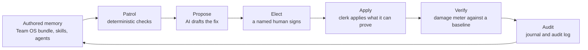

# Kernel Keeper

Teams now hand AI agents their internal documents and tell them to follow them. When a page is out of date, has no owner, or quietly contradicts another, the agent acts on it and gets things wrong, and nobody notices. Kernel Keeper checks those documents on a schedule and lists what has gone stale. It drafts a fix for each problem, but a named person has to approve it before anything is changed. You can run it in two minutes with no API key.

The tool finds problems and drafts fixes. A named person approves each fix before anything changes. A deterministic step then applies only what it can prove is safe, and records it in an audit trail.

## The words this README uses

- **Register:** a folder of authored files that agents rely on. Either a *knowledge bundle* (linked markdown pages) or a *procedure estate* (the skills, agents and commands that tell agents how to act).
- **Patrol:** the deterministic checks over a register. No AI, no key.
- **Proposal:** a drafted fix, saved as a file next to the register, never inside it.
- **Elect:** a named person approves a proposal. Until then nothing is applied.
- **Scribe:** the AI role that drafts a proposal for each patrol finding.
- **Clerk:** the step that applies elected proposals. It is plain code, previews first, and refuses anything stale or ambiguous.
- **Glass:** a local web page for reviewing proposals and approving them without Markdown, Git or the command line.
- **Damage Meter:** `verify`, which compares a register with a snapshot taken before a change and reports what went missing.

## The loop



The patrol is deterministic and needs no key. AI only appears after it, to draft proposals, and a proposal cannot enter the register until a named person elects it.

## Quickstart (no API key)

Needs Node 22 or later.

1. **Clone.**
   ```bash
   git clone https://github.com/cla1redonald/kernel-keeper-public && cd kernel-keeper-public
   ```
2. **Build.**
   ```bash
   npm ci && npm run build
   ```
3. **Run the patrol** on the bundled Northwind fixture, with the wiki-memory checks on.
   ```bash
   node dist/cli.js tests/fixtures/northwind-memory-lab/bundle --memory
   ```
4. **Open the review console** on a throwaway copy of the fixture.
   ```bash
   node dist/cli.js glass-demo
   ```

Step 3 exits `1` because it has a medium finding. Real output from running it on 2026-10-11:

```markdown
# Patrol report: bundle

*kernel-keeper · 2026-10-11 · 7 concepts · 1 definitions*

**2 findings**: 0 high · 1 medium · 1 low. Mostly healthy: a round of affirm-or-amend would clear it.

## data-ops (1 item)

- **[LOW]** `definitions/consent-lifecycle.yml` No concept links to this definition *(pointer-integrity)*
  - Reference it from the concept's Formula line, or retire it.

## Needs an owner (1 item)

- **[MED]** `log.md` Last journal entry is 83 days old (policy: 30) *(journal)*
  - Either nothing changed (affirm it in the log) or changes are bypassing the journal.

---
*The keeper reports and proposes; it never edits. Owners affirm or amend; the judgment stays human.*
```

Step 4 copies the fixture to a temp folder and opens Glass, the local review console, with a drafted proposal waiting. Approve it, apply it, and read the audit history. The walkthrough is in [docs/demo/glass-demo-script.md](docs/demo/glass-demo-script.md).

### With an API key

```bash
node dist/cli.js propose path/to/bundle --out-dir proposals/ --dry-run   # prints the prompts, zero API calls
export ANTHROPIC_API_KEY=...
node dist/cli.js propose path/to/bundle --out-dir proposals/             # the Scribe drafts one proposal per file
# a human ticks Elect in a proposal, or approves it in Glass or Notion
node dist/cli.js apply path/to/bundle --proposals proposals/             # dry-run diff; add --write to apply
```

Exit codes: `0` clean, `1` findings at or above `--fail-on` (default `med`), `2` any HIGH finding, `64` bad invocation, `66` nothing to load. Use `--fail-on high` to gate CI.

## What it checks

| Family | Catches | Severity |
|---|---|---|
| Links and pointers | Links that resolve to nothing, definitions and concepts that do not point at each other | HIGH |
| Metadata | Missing or invalid frontmatter, duplicate or malformed `id:` values | HIGH/MED |
| Freshness | Pages past the affirm-or-amend window, a silent journal, changes that bypassed the journal | MED |
| Ownership | Concepts and items nobody is accountable for | MED/LOW |
| Structure | Missing index, orphans, supersession with no replacement | HIGH/LOW |
| Memory mode (`--memory`) | Weak index lines, missing claim receipts, undeclared generated caches, archive and compartment leaks | MED/HIGH |
| Procedure estate (`--register`) | Agents invisible to the registry, skills without `SKILL.md`, retired tool names, name collisions, dangling paths | HIGH/MED/LOW |

Third-party plugins get shape checks only. Every check, its severities and the exit codes are in [docs/checks.md](docs/checks.md).

## What is tested

- **322 tests in 21 files.** With the build in place and no API keys set, 316 run and 6 skip. The 6 patrol the real Northwind Money bundle from the companion repo and run when `TEAM_OS_PATH` points at a checkout. CI clones it, so all 322 run there.
- **Fault-seeded fixtures.** `tests/fixtures/governance-repo`, `mini-repo` and `estate` are built with known faults (dangling links, duplicate IDs, a superseded item with no replacement, an agent with no frontmatter) and the tests pin the exact findings the patrol must report, and no others. Verify tests plant damage after a baseline and assert it is caught.
- **Prompts are inspectable before anything is spent.** `propose --dry-run` prints the exact prompts and makes zero API calls. Every proposal records a reproducible `prompt-sha256`, the evidence files and the reviewed-surface hashes, so `apply` refuses a proposal whose target has changed since it was drafted.
- **Cost is visible and capped.** `propose` and `drift` print an input-token estimate before the first call. `mine` takes `--max-calls` (default 25) and aborts before spending if the run would need more.
- **Hostile content is contained in code, not only in the prompt.** Fenced content is treated as data, with delimiter escaping, and the validator and apply plan refuse out-of-root targets and restore `needs-human`. See `tests/ai-injection.test.ts`, where a stubbed model obeys an injected instruction and is refused.
- **The review console is locked to one source.** It checks Host and Origin, requires a per-session token on every POST, and records the reviewer you name. See `tests/glass-security.test.ts`.

## Where things live

| Path | What is there |
|---|---|
| `src/core`, `src/checks` | Loading bundles and estates, and the deterministic checks |
| `src/ai` | The Scribe, Gap-Miner and Drift Reviewer: prompt assembly, provenance, validation |
| `src/apply`, `src/verify.ts` | The Clerk and the Damage Meter |
| `src/glass` | The local review console and the Notion approval surface |
| `tests/fixtures` | The Northwind memory lab and the fault-seeded fixtures |

## Companion

[Team OS](https://github.com/cla1redonald/team-os) is the shared-context pattern this patrols: plain markdown, no vector store, owners and dates on every page. Its Northwind Money bundle is the worked example, and the integration tests patrol it on every CI run.

## Boundaries

- It never edits your register on its own. Apply is a dry run until you pass `--write`, and it refuses anything not elected, stale or ambiguous.
- Glass serves only the source it was started with, on this machine only, and signs elections with the reviewer you name.
- It does not decide what is true. It cannot tell you which of two conflicting definitions is right, only that they conflict.
- It does not follow symlinks, patrol third-party plugin content beyond shape checks, or run a shell. The only commands it executes are the ones you pass to `verify --generator`, and those run without one.
- It is not a retrieval product. There are no embeddings and no vector store.
- The AI layer needs `ANTHROPIC_API_KEY`. Notion sync needs `NOTION_TOKEN`. Neither is needed for the patrol, apply, verify or Glass.

## More

- [Usage, CI recipe, notifications, library use](docs/usage.md)
- [All checks and exit codes](docs/checks.md)
- [The AI layer: Scribe, Gap-Miner, Drift Reviewer, Clerk, Glass, Notion](docs/ai-layer.md)
- [Memory doctrine](docs/memory-doctrine.md)
- Design notes: [wiki memory invariants](docs/design/wiki-memory-invariants.md), [applying elected proposals](docs/design/apply-elected-proposals.md)
- [Changelog](CHANGELOG.md)

MIT licence. Copyright 2026 Claire Donald.
