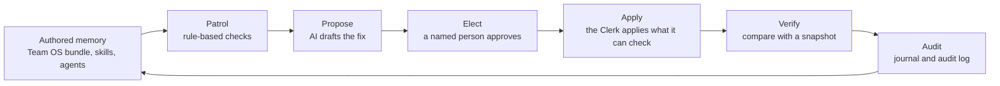

# Kernel Keeper

More and more teams give AI agents their internal documents and tell the agents to follow them. When one of those pages is out of date, has no owner or contradicts another page, the agent follows it anyway and gets things wrong, and often nobody notices. Kernel Keeper checks those documents on a schedule and lists what has gone stale or broken. It can draft a fix for each problem, but nothing changes until a named person has approved the fix. Approved fixes are then applied by ordinary code, with no AI in it, which refuses anything it cannot apply safely and records every change it makes. You can try it in two minutes without an API key.

## The words this README uses

| Word | What it means here |
|---|---|
| Register | A folder of files that people write and agents rely on. It is either a *knowledge bundle*, which is a set of linked markdown pages about what the team knows, or a *procedure estate*, which is the skills, agents and commands that tell agents how to act. |
| Patrol | The checks Kernel Keeper runs over a register. They follow fixed rules, so there is no AI involved and no key needed. |
| Proposal | A drafted fix, saved as a file beside the register and never inside it. |
| Elect | What a named person does to approve a proposal. Until someone elects it, nothing is applied. |
| Scribe | The AI role that drafts a proposal for each problem the patrol finds. |
| Clerk | The step that applies elected proposals. It is plain code. It shows you a preview first, and it refuses any proposal that is out of date or unclear. |
| Glass | A web page that runs on your own machine, where you can read proposals and approve them without using Markdown, Git or the command line. |
| Damage Meter | The `verify` command. You take a snapshot of a register before a change, and afterwards it tells you what went missing. |

## The loop



Only the propose step uses AI. The patrol before it needs no key, and whatever the AI drafts stays outside the register until a named person elects it.

## Quickstart (no API key)

You need Node 22 or later.

1. Clone the repository.
   ```bash
   git clone https://github.com/cla1redonald/kernel-keeper && cd kernel-keeper
   ```
2. Build it.
   ```bash
   npm ci && npm run build
   ```
3. Run the patrol on the bundled Northwind fixture, with the wiki-memory checks switched on.
   ```bash
   node dist/cli.js tests/fixtures/northwind-memory-lab/bundle --memory
   ```
4. Open the review console on a throwaway copy of the fixture.
   ```bash
   node dist/cli.js glass-demo
   ```

Step 3 exits with code `1`, because the fixture has one medium finding. This is what it printed when it was run on 2026-10-11.

```markdown
# Patrol report: bundle

*kernel-keeper · 2026-10-11 · 7 concepts · 1 definitions*

**2 findings**: 0 high · 1 medium · 1 low. Mostly healthy: a round of affirm-or-amend would clear it.

## data-ops (1 item)

- **[LOW]** `definitions/consent-lifecycle.yml` No concept links to this definition *(pointer-integrity)*
  - Reference it from the concept's Formula line, or retire it.

## Needs an owner (1 item)

- **[MED]** `log.md` Last journal entry is 83 days old (policy: 30) *(journal)*
  - Either nothing changed (affirm it in the log) or changes are bypassing the journal.

---
*The keeper reports and proposes; it never edits. Owners affirm or amend; the judgment stays human.*
```

Step 4 copies the fixture into a temporary folder and opens Glass with a drafted proposal waiting. You can approve the proposal, apply it and then read the audit history. [docs/demo/glass-demo-script.md](docs/demo/glass-demo-script.md) walks through it screen by screen.

### With an API key

With a key set, the Scribe drafts proposals and the Clerk applies the ones a person has elected. Run with `--dry-run` first if you want to read the exact prompts before anything is spent.

```bash
node dist/cli.js propose path/to/bundle --out-dir proposals/ --dry-run   # prints the prompts, makes no API calls
export ANTHROPIC_API_KEY=...
node dist/cli.js propose path/to/bundle --out-dir proposals/             # the Scribe drafts one proposal per file
# a person ticks Elect in a proposal, or approves it in Glass or Notion
node dist/cli.js apply path/to/bundle --proposals proposals/             # shows the diff; add --write to apply it
```

The patrol exits with `0` when it is clean, `1` when there are findings at or above `--fail-on` (default `med`), `2` for any HIGH finding, `64` for a bad invocation and `66` when there is nothing to load. If you only want CI to fail on serious problems, use `--fail-on high`.

## What it checks

| Family | Catches | Severity |
|---|---|---|
| Links and pointers | Links that resolve to nothing, definitions and concepts that do not point at each other | HIGH |
| Metadata | Missing or invalid frontmatter, duplicate or malformed `id:` values | HIGH/MED |
| Freshness | Pages past the affirm-or-amend window, a silent journal, changes that bypassed the journal | MED |
| Ownership | Concepts and items nobody is accountable for | MED/LOW |
| Structure | Missing index, orphans, supersession with no replacement | HIGH/LOW |
| Memory mode (`--memory`) | Weak index lines, missing claim receipts, undeclared generated caches, archive and compartment leaks | MED/HIGH |
| Procedure estate (`--register`) | Agents invisible to the registry, skills without `SKILL.md`, retired tool names, name collisions, dangling paths | HIGH/MED/LOW |

Third-party plugins are only checked for shape. [docs/checks.md](docs/checks.md) lists each check with its severities, and the exit codes.

## What is tested

- There are 332 tests in 22 files. With the build in place and no API keys set, 326 run and 6 skip. The 6 that skip patrol the real Northwind Money bundle from the companion repo, and they run when `TEAM_OS_PATH` points at a checkout of it. CI clones that repo, so all 332 run there.
- Three fixtures, `tests/fixtures/governance-repo`, `mini-repo` and `estate`, have faults planted in them on purpose, such as dangling links, duplicate IDs, a superseded item with no replacement and an agent with no frontmatter. The tests pin the exact findings the patrol must report for each one, and fail if it reports anything else. The verify tests take a baseline, plant damage after it, and check the damage is caught.
- You can read the prompts before you spend anything. `propose --dry-run` prints them exactly and makes no API calls. Each proposal records a `prompt-sha256` you can reproduce, the evidence files, and hashes of the files the reviewer saw. If the target has changed since the proposal was drafted, `apply` refuses it.
- `propose` and `drift` print an estimate of input tokens before the first call. `mine` takes `--max-calls` (default 25) and stops before spending anything if the run would need more calls than that.
- Content in the register is treated as untrusted, and the protection is in the code as well as the prompt. Fenced content is handled as data, with its fence delimiters escaped. The validator and the apply plan both refuse targets outside the root and make sure `needs-human` is set. In `tests/ai-injection.test.ts`, a stubbed model obeys an instruction hidden in the content and the code refuses what it produces.
- Glass only serves the source it was started on. It checks the Host and Origin headers, needs a per-session token on every POST and records the reviewer you name. The tests for this are in `tests/glass-security.test.ts`.

## Where things live

| Path | What is there |
|---|---|
| `src/core`, `src/checks` | Loading bundles and estates, and the patrol checks |
| `src/ai` | The Scribe, Gap-Miner and Drift Reviewer, with prompt assembly, provenance and validation |
| `src/apply`, `src/verify.ts` | The Clerk and the Damage Meter |
| `src/glass` | The local review console and the Notion approval surface |
| `tests/fixtures` | The Northwind memory lab and the fixtures with planted faults |

## Companion

Kernel Keeper was built to patrol [Team OS](https://github.com/cla1redonald/team-os), a way of keeping a team's shared context in plain markdown with an owner and a date on every page, and no vector store. Team OS comes with a worked example, the Northwind Money bundle, which the integration tests patrol on every CI run.

## Boundaries

- Kernel Keeper never edits your register on its own. `apply` is a dry run until you pass `--write`, and even then it refuses anything that has not been elected, is out of date or is ambiguous.
- Glass serves only the source it was started with, and only to this machine. It signs each election with the name of the reviewer you gave it.
- It does not decide what is true. If two definitions conflict, it can tell you that they conflict, but not which one is right.
- It does not follow symlinks or run a shell, and it looks at third-party plugin content only to check its shape. The only commands it ever executes are the ones you pass to `verify --generator`, and those run without a shell.
- This is not a search or retrieval product. There are no embeddings and no vector store.
- The AI steps need `ANTHROPIC_API_KEY` and Notion sync needs `NOTION_TOKEN`. The patrol, apply, verify and Glass need neither.

## More

- [Usage, CI recipe, notifications, library use](docs/usage.md)
- [All checks and exit codes](docs/checks.md)
- [The AI layer: Scribe, Gap-Miner, Drift Reviewer, Clerk, Glass, Notion](docs/ai-layer.md)
- [Memory doctrine](docs/memory-doctrine.md)
- Design notes: [wiki memory invariants](docs/design/wiki-memory-invariants.md), [applying elected proposals](docs/design/apply-elected-proposals.md)
- [Changelog](CHANGELOG.md)

MIT licence. Copyright 2026 Claire Donald.
